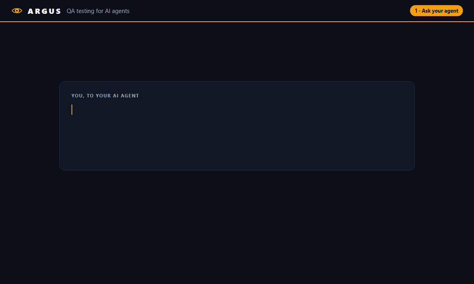

# Argus QA MCP

**Let Claude (or any MCP-capable AI agent) QA-test your web app, and leave evidence behind.**

Argus is a [Model Context Protocol](https://modelcontextprotocol.io) server that gives an AI agent a real Chromium browser through Playwright, plus the things you need to trust its results:

- **Recordings for review**: every session can produce a video, a Playwright trace (DOM snapshots, network and console for each step) and an HTML report of every action the agent took.
- **Real test verdicts**: `assert_text` / `assert_visible` return PASS or FAIL, and the report tallies them.
- **Network mocking**: simulate API errors, payment declines, outages and slow responses without touching your backend.
- **Safety guards**: refuses to enter card details on pages using a *live* payment environment, blocks live payment API traffic, optionally restricts which sites the agent may visit, and masks passwords and card numbers in recordings.



## Quick start

Requires Node.js 22+.

**1. Install the browser (once):**

```sh
npx playwright install chromium
```

Or skip this and use your installed Google Chrome by setting `ARGUS_BROWSER_CHANNEL=chrome` (see [Configuration](#configuration)).

**2. Add Argus to your client.**

Claude Code:

```sh
claude mcp add argus -- npx -y argus-qa-mcp
```

Claude Desktop: add this to `claude_desktop_config.json` (on Windows `%APPDATA%\Claude\`, on macOS `~/Library/Application Support/Claude/`) and restart:

```json
{
  "mcpServers": {
    "argus": {
      "command": "npx",
      "args": ["-y", "argus-qa-mcp"]
    }
  }
}
```

**3. Ask for a test:**

> Start a recording called "login flow". Go to https://the-internet.herokuapp.com/login, log in as tomsmith / SuperSecretPassword!, assert that "You logged into a secure area!" is shown, report any console errors, then stop the recording and suggest a fix for anything that failed.

Argus writes the recording to `~/argus-qa/recordings/<date>_login-flow/`. Open `report.html` to review it.

## Tools

| Tool | What it does |
|---|---|
| `navigate_url` | Open a URL; returns status code, final URL and title. Resets the console and network logs. |
| `get_page_snapshot` | Accessibility tree of the page (including iframes) with `[ref=eN]` handles. Pass `aria-ref=eN` as a selector to any other tool. |
| `click_element` | Click an element; waits for any navigation it triggers. |
| `fill_input` | Clear and fill a field. Password and card values are masked in recordings. |
| `select_option` | Choose option(s) in a `<select>` by value or label. |
| `press_key` | Press a key or chord (`Enter`, `Tab`, `Control+A`), optionally on an element. |
| `hover_element` | Hover an element (menus, tooltips). |
| `wait_for` | Wait for an element or text to become visible, hidden, attached or detached. |
| `take_screenshot` | Save a PNG (viewport or full page) and optionally return it. |
| `assert_text` | PASS if text is visible on the page or in an element, otherwise FAIL with the actual text. Optional `label` names the check in the report. |
| `assert_visible` | PASS if an element is visible (or hidden), otherwise FAIL. Optional `label`. |
| `get_console_errors` | Console errors, uncaught exceptions, failed requests, HTTP errors and guard blocks, deduplicated, optionally first-party only. |
| `get_network_requests` | The page's HTTP requests with status, timing, failures and mock hits. |
| `mock_route` | Answer matching requests with a canned response, a network error or a delay. |
| `clear_mocks` | Remove one mock or all of them. |
| `start_recording` | Start recording a trace, an optional video and the action log. |
| `stop_recording` | Save the recording and report; returns the verdict, failures (with screenshots and video times) and paths. |
| `suggest_fix` | Add the agent's diagnosis and suggested fix for a failed step to the report, tagged as an app, test or environment fix. |

Element tools accept a `frame` parameter (an iframe selector, or a list for nested iframes), though `aria-ref` selectors reach into iframes without it.

When a step fails, Argus explains it in plain language instead of returning Playwright's raw output, e.g. *"Element is covered: "#pay" was found, but another element is on top of it: `<div class="cookie-banner">`. Try: close the overlay first."* It recognizes missing, hidden, disabled and covered elements, stale `aria-ref`s, bad selectors, dropdown and field mismatches, wait and page-load timeouts, network errors (DNS, refused connections, certificates) and guard blocks.

## Configuration

All settings are environment variables, set in your client's MCP config (`"env": { ... }`, or `-e NAME=value` with `claude mcp add`).

| Variable | Default | Purpose |
|---|---|---|
| `ARGUS_HEADLESS` | `true` | `false` shows the browser window. |
| `ARGUS_BROWSER_CHANNEL` | *(bundled Chromium)* | `chrome`, `msedge` (or `-beta`) to use an installed browser. |
| `ARGUS_ALLOWED_HOSTS` | *(any)* | Comma-separated hosts the agent may open as pages, e.g. `staging.myapp.com,localhost`. Subdomains included. |
| `ARGUS_RECORD` | `false` | `true` records every session automatically; saved when the client disconnects. |
| `ARGUS_RECORDINGS_DIR` | `~/argus-qa/recordings` | Where recordings are written. |
| `ARGUS_SCREENSHOT_DIR` | `~/argus-qa/screenshots` | Where screenshots are written. |

Email and notifications (see [Delivering reports](#delivering-reports)):

| Variable | Default | Purpose |
|---|---|---|
| `ARGUS_EMAIL_TO` | *(off)* | Comma-separated recipients of every report, e.g. `client@acme.com,qa@yourco.com`. |
| `ARGUS_EMAIL_FROM` | `ARGUS_SMTP_USER` | Sender address. |
| `ARGUS_SMTP_HOST` / `ARGUS_SMTP_PORT` | — / `587` | Your SMTP server (Gmail, Microsoft 365, SendGrid, Amazon SES, Postmark, ...). |
| `ARGUS_SMTP_USER` / `ARGUS_SMTP_PASS` | — | SMTP login (for Gmail, an app password). |
| `ARGUS_SMTP_SECURE` | `true` on port 465 | Implicit TLS. Otherwise STARTTLS is required, except to localhost. |
| `ARGUS_EMAIL_WAIT_SECONDS` | `180` | How long to wait for the agent's suggested fixes before emailing anyway. `0` sends at once. |
| `ARGUS_EMAIL_ATTACH_VIDEO` | `true` | Attach the screen recording when it fits. |
| `ARGUS_EMAIL_MAX_MB` | `20` | Size limit for the email; videos that don't fit are left out. |
| `ARGUS_NOTIFY_WEBHOOK` | *(off)* | URL notified when an assessment finishes: a Slack or Discord incoming webhook, or any endpoint (Teams/Power Automate, Zapier, your own API) that accepts JSON. |

## Safety model

Argus is meant for testing **sites you own or are authorized to test**, ideally staging environments with test payment credentials.

| Guard | Behavior |
|---|---|
| Payment guard (always on) | Blocks requests that use Stripe live keys (`pk_live_`/`sk_live_`/`rk_live_`) or that reach Adyen live, Braintree production or PayPal live REST APIs, and refuses to type into card fields on a page that loads a live key. Test and sandbox modes are unaffected. |
| Host allowlist (opt-in) | With `ARGUS_ALLOWED_HOSTS` set, top-level navigation to any other host is refused, whether by `navigate_url` or by a link click. Sub-resources such as CDNs still load. |
| Secret masking | Values typed into password and payment-card fields are replaced with `••••••` in `actions.json` and `report.html`. |
| Fixed recipients | Reports are emailed and notifications sent only to the addresses and webhook in the server's environment, never to anything an agent supplies. |

**Limits you should know about:**

- The **Playwright trace (`trace.zip`) and the video still contain typed values** (card numbers are visible on screen in the video). Treat recordings as sensitive. The video is emailed with the report unless `ARGUS_EMAIL_ATTACH_VIDEO=false`, so use test card numbers.
- The payment guard recognizes **Stripe, Adyen, Braintree and PayPal** only. It can't detect other providers, or a backend that charges cards server-side with its own secret key. It is a safety net, not proof that a site is in test mode.
- `firstPartyOnly` compares the last two labels of the host name, so it treats e.g. `a.co.uk` and `b.co.uk` as the same site.

## Recordings

`start_recording` → (test steps) → `stop_recording` produces:

```
~/argus-qa/recordings/2026-10-24_22-43-42_login-flow/
├── report.html     # verdict, test results, explained errors, website errors, video, screenshots, full log
├── trace.zip       # open with: npx playwright show-trace trace.zip  (or drag onto trace.playwright.dev)
├── video.webm
├── actions.json    # machine-readable log of every tool call
├── failures/       # automatic screenshot of the page at each failed check or step
└── screenshots/    # screenshots taken with take_screenshot
```

The report is headed with **the website tested**: its name (the home page's title, or the brand part its page titles share, such as "Acme Shop" from "Log in | Acme Shop") and its address, followed by the test run's name and times. `stop_recording` returns the same as `site`.

It opens with a **PASSED / FAILED verdict** (failed if any check fails or any step errors), then:

- **Test results**: every `assert_text` / `assert_visible` check with PASS or FAIL, the page it ran on, and for failures the expected-vs-actual detail.
- **Errors during the run**: each failed step with what went wrong, why, and what to try.
- **Errors from the website**: console errors, uncaught exceptions and failed requests the site produced during the run, collected automatically and de-duplicated.

The report uses the Argus theme: a branded header bar with the verdict, light or dark to match the viewer's system setting, and always light when printed. It is a single self-contained file with no external fonts or scripts, so it works offline and sends nothing anywhere.

Every section can be hidden: click its heading, or use **Show all / Hide all sections** at the top. A hidden section's heading still shows a count (e.g. *Errors from the website · 11 errors*). Hidden sections are left out when the report is printed or saved as PDF, so you can share a trimmed version.

Every failure comes with evidence: a **screenshot of the page at the moment it failed**, shown beside the explanation (click it for full size), and an approximate **video timestamp** such as "▶ 0:12 in video". Clicking it jumps the embedded player to just before the failure. Password and card fields are blacked out in failure screenshots.

`stop_recording` returns the same verdict, failed checks and step errors, each with its screenshot path and video time, so the agent can summarize the outcome directly.

**The agent's suggested fixes.** When something failed, `stop_recording` asks the agent to call `suggest_fix` for each failed step. The agent's diagnosis and fix then appear in an *AI agent's suggested fix* column of the test results, and on each error card, tagged **Fix in the app** (a real bug), **Fix in the test** (wrong selector or expectation) or **Fix the environment** (e.g. server down). This is separate from Argus's built-in *Try:* hints. The report is rewritten after each suggestion, so this works after the recording has stopped, and each `suggest_fix` reply lists the failures still without one.

### Delivering reports

When the agent runs on a server the client can't access, Argus can deliver each recording itself:

1. **Notification when the assessment finishes.** As soon as `stop_recording` runs, Argus posts to `ARGUS_NOTIFY_WEBHOOK`. Slack gets the message as `text`, Discord as `content`, and any other URL gets JSON with `event: "assessment.finished"`, the verdict, site, counts and failed checks.
2. **The report by email.** Argus emails `ARGUS_EMAIL_TO` a branded summary of what failed, with each failure's explanation and the agent's suggested fix. It attaches `report.html` and the video. The attached report is a single file with screenshots built in, so it opens anywhere.
   - A run where nothing failed is emailed right away.
   - A run with failures is emailed once the agent has called `suggest_fix` for every failure, so the client gets the fixes too. If that doesn't happen within `ARGUS_EMAIL_WAIT_SECONDS`, it is sent anyway. It is also sent when the next recording starts or the client disconnects.

`stop_recording` and `suggest_fix` report what was sent (or why not) under `delivery`.

Recipients and the webhook come **only from the server's configuration**. No tool takes an address, so a page under test can't trick the agent into sending the report elsewhere. The Playwright trace is never emailed, because it holds every typed value.

```sh
claude mcp add argus \
  -e ARGUS_EMAIL_TO=client@acme.com \
  -e ARGUS_SMTP_HOST=smtp.sendgrid.net -e ARGUS_SMTP_USER=apikey -e ARGUS_SMTP_PASS=SG.xxxx \
  -e ARGUS_EMAIL_FROM=qa@yourco.com \
  -e ARGUS_NOTIFY_WEBHOOK=https://hooks.slack.com/services/T000/B000/XXXX \
  -- npx -y argus-qa-mcp
```

Starting a recording with video reloads the current page into a new browser context. Cookies, localStorage and the URL are kept; unsaved in-page state is not. Use `video: false` to record just the trace without a reload.

## Development

```sh
npm install
npx playwright install chromium
npm run build       # compile src/ to dist/
npm run typecheck   # strict type-check without emitting
npm run dev         # run the server from source with tsx
```

To try a local build in Claude Code: `claude mcp add argus-dev -- node /path/to/argus-qa-mcp/dist/index.js`.

## License

[MIT](LICENSE)
